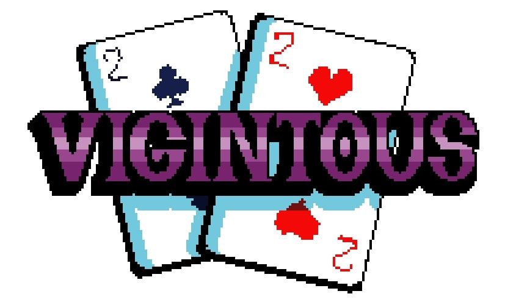

VIGINTOUS

1. como abrir el juego?
- descargar el ViginTous.exe y ejecutar en su computadora (tener java 25 instalado es obligatorio)

Las cartas:

Carta: Una Carta tiene un palo (corazones, picas...) y un valor (del 2 al As).
Mazo: El Mazo es una pila de cartas que se puede barajar y repartir.
Mano: La Mano son las cartas que tiene alguien en este momento y sabe calcular cuántos puntos suman, si es blackjack o si se pasó de 21.

Jugador:

Un Jugador tiene nombre, dinero, una mano y una lista de habilidades. Puede apostar, recibir cartas y decidir si pide otra o se planta.
El Crupier es un jugador especial: hereda todo lo del jugador, pero decide de otra forma (pide carta hasta llegar a 17) y puede tener una carta oculta.

Juego:

Juego es el que organiza todo. Tiene el mazo y la lista de jugadores, reparte las cartas, lleva las rondas y decide quién gana.

Habilidades:

Una Habilidad es como una carta de poder que el jugador lleva consigo. Cada una dice dos cosas: cuándo se activa y qué hace.
Ese "cuándo" viene del enum Momento, por ejemplo al repartir, al pedir carta o al calcular los puntos.
Lo que hace lo aplica sobre el ContextoRonda, que es la hoja de apuntes de la ronda con los puntos y el multiplicador actuales.

Las tres habilidades  son:
DuplicarPuntos: que multiplica tu puntaje.
BonusPorFigura: que te da puntos extra por cada J, Q o K.
SeguroDePasarse: que te perdona una vez si te pasas de 21.

